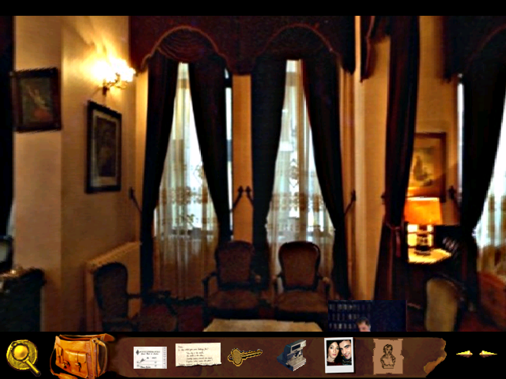
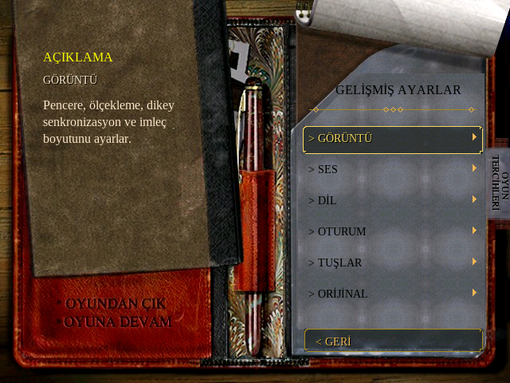
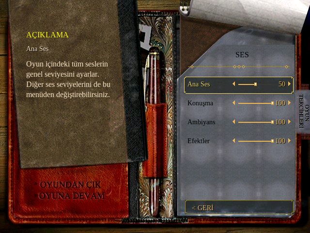

<div align="center">

# OpenByzantine

### Byzantine: The Betrayal için taşınabilir C++17 oyun motoru

Özgün oyun verileri, yeniden kurulan motor, güncel masaüstü kontrolleri.

*A portable reconstruction of Byzantine: The Betrayal, powered by SDL2 and original game data.*

<p>
  
  
  
  
</p>

**[Özellikler](#özellikler) · [Kurulum](#hızlı-başlangıç) · [Kontroller](#kontroller) · [Ekranlar](#oyuncudan-görüntüler) · [Teknik yapı](#teknik-yapı) · [Katkı](#katkıda-bulunma)**

</div>



OpenByzantine, **Byzantine: The Betrayal** oyununu özgün Windows motoruna
bağımlı olmadan çalıştırmak için geliştirilen bir motor rekonstrüksiyonudur.
Sahne betikleri, panoramalar, konuşmalar, envanter ve kayıt sistemi C++17 ile
yeniden uygulanır. Pencere, girdi ve ses çıkışını SDL2; AVI çözümlemeyi FFmpeg
üstlenir. Oyun mantığı, özgün dosyalardaki tablolardan ve betiklerden gelir.

**Oynamak için orijinal oyun verileri gerekir.** Kurulum akışı şu anda altı
CD'lik Türkçe sürümün ISO düzenine göre hazırlanmıştır. Motor geliştirme
aşamasındadır; baştan sona eksiksiz bir oyun testi veya bütün platformlarda
eşdeğer davranış iddiası yoktur.

## Özellikler

| Alan | Yapabilecekleriniz |
| --- | --- |
| **Sahne keşfi** | Etkin nesnelere tıklayın, panoramalarda yön değiştirin ve bağlantılı mekânlar arasında ilerleyin. Haritada bir hedefin üzerine gelince oyunun kendi vurgusu görünür; ardından tek tıklamayla seyahat edebilirsiniz. |
| **Konuşmalar ve filmler** | Diyalogları, cevap seçeneklerini, altyazıları ve oyun içi AVI kliplerini takip edin. Konuşma geçmişini açın; önceden gördüğünüz satırları atlamayı seçin. |
| **Envanter ve defter** | Eşyaları inceleyin ve kullanın; üst çubuktan notlara, temas listesine, keşif ekranına ve ipuçlarına erişin. |
| **Kayıt ve devam** | Oyun içi kayıt/yükleme ekranını, hızlı kaydı ve sahne geçişlerinden sonra yazılan otomatik kaydı kullanın. Otomatik kayda komut satırından da dönebilirsiniz. |
| **Görüntü** | Pencereli, çerçevesiz tam ekran, özel tam ekran veya maksimize görünümü seçin. 4:3 oranını koruyan ölçekleme, tam sayı ölçekleme, VSync ve imleç boyutu ayarlarını değiştirin. |
| **Ses** | Ana ses, konuşma, ambiyans ve efekt seviyelerini ayrı ayarlayın. Pencere odağı kaybolduğunda sesi otomatik kapatmayı açıp kapatın. |
| **Kontroller** | Fare ve klavyeyi kullanın; port kısayollarını yeniden atayın. Gamepad ile imleci taşıyın, tıklayın ve ayarları açın. |
| **Dil altyapısı** | Kurulu paketlerden metin ve ses dilini ayrı seçin. Hazırlanmış yerelleştirilmiş veri ağaçlarından fark tabanlı dil paketleri üretin. Diğer dillerin gerçek paketleri henüz dağıtılmıyor. |
| **Geliştirme araçları** | Başsız sahne kontrolleri, ekran görüntüleri, isteğe bağlı hotspot çizgileri ve her çalıştırmaya özel log paketleriyle bir hatanın akışını inceleyin. |

## Oyuncudan görüntüler

<table>
  <tr>
    <td align="center"><br><strong>Defter biçiminde gelişmiş ayarlar</strong></td>
    <td align="center"><br><strong>Ayrı ses kanalları ve kaydırıcılar</strong></td>
  </tr>
</table>

Görseller mevcut oyuncunun kaydedilmiş çıktılarıdır; tasarım maketi değildir.
Oynanış görseli önceki bir pencere kaydından, ayar görselleri son menü
doğrulamasından alınmıştır. Oyuna ait görsel içerikler özgün oyun verilerinden
gelir. Kaynaklar [ekran görüntüsü notlarında](docs/images/README.md) listelenmiştir.

## Hızlı başlangıç

### 1. Gereksinimler

| Bileşen | Kullanım |
| --- | --- |
| C++17 derleyicisi ve GNU Make | Motoru ve test araçlarını derlemek |
| SDL2 geliştirme dosyaları ve `pkg-config` | Pencere, girdi, ses ve derleme bayrakları |
| Python 3 | Başlatıcı logları, dil paketi araçları ve Python testleri |
| Bash ve `7z` | CD görüntülerinden çalışma kopyasını hazırlamak |
| `ffmpeg` ve `ffprobe` | AVI ve konuşma medyasını çözümlemek |
| CMake, isteğe bağlı | Alternatif derleme yolu |
| Orijinal altı CD'nin ISO dosyaları | Oyun verilerini sağlamak |

Linux, mevcut geliştirme ve doğrulama ortamıdır. C++17/SDL2 taşınabilirliği
hedeflenir; Windows ve macOS için burada doğrulanmış kurulum veya hazır paket
sunulmuyor. Bash başlatıcıları ayrıca bu araçların bulunduğu bir ortam gerektirir.

Debian/Ubuntu için bağımlılık örneği:

```bash
sudo apt install build-essential pkg-config libsdl2-dev python3 p7zip-full ffmpeg
```

### 2. Depoyu klonlayın ve derleyin

```bash
git clone https://github.com/baturkacamak/openbyzantine.git
cd openbyzantine
make -C port -j2 all test
```

Derleme `port/` altında şu araçları oluşturur:

| Araç | Görevi |
| --- | --- |
| `byzantine-play` | SDL2 sahne oyuncusu |
| `byzantine-cc` | Sahne betiklerini, etiketleri ve oyun durumunu inceleme |
| `byzantine-all` | Oyunun `.ALL` arşivlerini ayırma |
| `byzantine-rle` | Özel RLE görsellerini çözümleme |

Dosya adları mevcut araçlarla uyumluluk için `byzantine-*` olarak korunur;
projenin adı **OpenByzantine**, depo ve klasör adı **`openbyzantine`**'dır.

<details>
<summary><strong>Alternatif: CMake ile derleme</strong></summary>

SDL2 ve CMake kurulu bir ortamda:

```bash
cmake -S port -B port/build
cmake --build port/build -j2
ctest --test-dir port/build --output-on-failure
```

CMake çıktıları `port/build/` içine yazılır. `scene.sh` ise `port/` içindeki
araçları kullanır; aşağıdaki başlatıcı örnekleri için Make yolunu kullanın.
Make ve CMake test listeleri aynı değildir.

</details>

### 3. Oyun dosyalarını hazırlayın

ISO'ları ayrı bir klasörde şu iki düzenden biriyle tutabilirsiniz:

```text
oyun-dosyaları/
├── Byzantine_1.iso
├── Byzantine_2.iso
├── Byzantine_3.iso
├── Byzantine_4.iso
├── Byzantine_5.iso
└── Byzantine_6.iso
```

Alternatif olarak her ISO, `Byzantine-The-Betrayal_Win_TR_CD1/Byzantine_1.iso`
biçiminde, numarası 1–6 arasında değişen kendi alt klasöründe bulunabilir.
Orijinal dosyalar yerinde kalır; başlatıcı gerekli verileri ayrı bir çalışma
dizinine çıkarır.

### 4. Haritayı açın

Depo kökünden:

```bash
GAME_DIR="/oyun-dosyalarının/tam/yolu"
export BYZ_DATA="$HOME/.local/share/openbyzantine/game-data"

./port/scene.sh "$GAME_DIR"
```

Bu komut varsayılan olarak oyunun `tempsave.btb` kaydıyla **MAP** sahnesini
açar. Bu, haritadan başlayan bir oynanabilir giriş noktasıdır. İlk çalıştırma
veri çıkarma ve tablo hazırlama nedeniyle daha uzun sürebilir.

`BYZ_DATA` verilmezse başlatıcı `${TMPDIR:-/tmp}/byz-scene` kullanır. Kayıtlar
da hazırlanan veri ağacında tutulduğundan, kalıcı ilerleme için yukarıdaki gibi
kalıcı bir dizin seçin ve sonraki çalıştırmalarda aynı değeri kullanın.

### 5. Filmleri önceden çıkarın ve kayıttan devam edin

İlk başarılı hazırlamadan sonra tüm diyalog ve filmleri önceden çıkarmak için:

```bash
./port/full_install.sh "$GAME_DIR" "$BYZ_DATA"
```

Bu araç altı diskteki `dialog/`, `video/` ve `avi/` dosyalarını çalışma
dizinine kopyalar. Eksik diskleri atladığı için çıktıda **altı diskin de**
işlendiğini kontrol edin. Normal başlatıcı ISO yollarını hâlâ kullanır;
ISO'ları kaldırmayın veya taşımayın.

Otomatik kayıt oluştuktan sonra, aynı `BYZ_DATA` değeriyle:

```bash
./port/continue.sh "$GAME_DIR"
```

Otomatik kayıt, ilgili ayar açıkken sahne geçişlerinden sonra yazılır.

## Kontroller

| Girdi | İşlev |
| --- | --- |
| Fare | Etkin alanları seçme, eşya kullanma, menülerde gezinme |
| Ekranın üst kenarı | Kayıt/yükleme, notlar, keşif ve tercihler çubuğunu açma |
| `F3` | Mevcut oturumun son 400 satırlık konuşma geçmişi |
| `F4` | Önceden görülmüş konuşmaları atlamayı açma/kapatma |
| `F5` / `F9` | Hızlı kayıt / hızlı yükleme |
| `F8` | Otomatik kaydı yükleme |
| `F10` | Gelişmiş ayarlar |
| `F11` | Pencereli / çerçevesiz tam ekran geçişi |
| `Alt+Enter` | Pencereli / özel tam ekran geçişi |
| `F12` | Ekran görüntüsü alma |
| `H` | Hotspot tanılama çizgilerini açma/kapatma |
| `Esc` | Açık ekranı kapatma veya oyuncunun o bağlamdaki geri/çıkış işlemi |

Bunlar varsayılan atamalardır. Port eylemlerinin tuşları **Gelişmiş Ayarlar →
Tuşlar** ekranından değiştirilebilir; `F11` ve `Alt+Enter` sabittir.
Gamepad'de sol çubuk imleci taşır; **A** tıklar, **B** geri gider,
**Start** ayarları, **X** konuşma geçmişini, **Y** görülen satır atlamayı açar.

## Ayarlar, kayıtlar ve dil paketleri

Üst çubuktan **TERCİHLER → GELİŞMİŞ AYARLAR** veya `F10` ile defter
biçimindeki ayar ekranını açın. Görüntü, ses, dil, oturum ve tuşlar ayrı
kategorilerdir. Orijinal oyun tercihleri ayrı bir salt okunur kategoride
görüntülenir; değişiklikleri oyunun kendi TERCİHLER ekranından yapılır.

| Konum | İçerik |
| --- | --- |
| `port/byzantine.ini` | `scene.sh` ile başlatıldığında port ayarları |
| INI'nin yanındaki `seen_dialogue.txt` | Görülmüş konuşma satırları |
| `$BYZ_DATA/copy2hd/savegame/` | Oyun kayıtları, `quicksave.btb` ve `autosave-port.btb` |
| `port/output/screenshots/` | `F12` ekran görüntüleri |
| `port/output/logs/` | Her başlatmaya ait log paketi |
| `$BYZ_DATA/lang/<kod>/` | İsteğe bağlı dil paketleri ve `pack.ini` |

`BYZ_CONFIG`, `BYZ_SCREENSHOT_DIR` ve `BYZ_LOG_DIR` ile ilgili konumlar
değiştirilebilir. INI ayarları, orijinal oyunun tercih dosyasından ayrıdır.
Oyuncu içeride 640×480 mantıksal çözünürlük kullanır; geniş ekranda 4:3 oranı
korunur. Tam ekran seçeneği oyunun görsellerini yeniden üretmez.

### Dil paketi oluşturma

Metin ve ses için ayrı dil seçimi desteklenir. Gerçek verilerle denenmiş taban
Türkçe sürümdür; diğer sürümlerin hazır dil paketleri depoda bulunmaz.
Elinizde başka bir sürümün hazırlanmış veri ağacı varsa önce uyumu inceleyin:

```bash
python3 port/language_audit.py \
  --base "$BYZ_DATA" \
  --pack en=/yerelleştirilmiş/hazır-veri

python3 port/language_pack.py \
  --base "$BYZ_DATA" \
  --code en \
  --source /yerelleştirilmiş/hazır-veri \
  --name English
```

Araç yalnızca tabandan farklı dosyaları paketler; çeviri üretmez.
Dil seçimi, paketler hazırsa:

```bash
./port/scene.sh "$GAME_DIR" MAP 87 tempsave.btb --text-lang en --voice-lang tr
```

## Mevcut durum ve sınırlar

| Konu | Durum |
| --- | --- |
| Sahne kapsamı | Kaydedilmiş kapsam taramasında 44 sahnenin girişleri değerlendirildi. Özel inceleme sahneleri eşya bağlamı, `morris` ise rastgelelik durumu gerektirdi. Bu sayı tam oyun bitirme testi değildir. |
| Görsel katmanlar | Arka planlar, panorama örnekleme, animasyon kayıtları, gölgeler, iz çizimi ve animasyonlu özgün imleçler uygulanmıştır. |
| Geçişler | Sahne değişimlerinde ortak geçiş sunucusu kullanılır. Varsayılan port geçişi, özgün betiklerin çoğundaki anında çizim davranışından farklıdır; `--no-transitions` ile kesme, `--transition 0x64` ile anında çizim seçilebilir. |
| Medya | Gerçek oyun AVI'leri FFmpeg ile denenmiştir. Bir dosyanın çözülebilmesi, bütün oyun akışının veya her ses aygıtının doğrulandığı anlamına gelmez. |
| Kayıt yükleme sesi | Kaydedilmiş ambiyans döngü zincirinin tam yeniden uygulanması yerine mevcut yaklaşım kullanılır; sahne ortası yüklemelerde özgün döngü durumuyla fark oluşabilir. |
| Diğer platform ve diller | Taşınabilir kaynak ve dil paketi altyapısı vardır; Windows/macOS dağıtımları ile gerçek Türkçe dışı paketlerin doğrulaması tamamlanmamıştır. |

Desteklenmeyen VM davranışları adlandırılmış tanılamalarla raporlanır.
Yeni özellikler için sahne adına özel kestirmeler eklemek yerine ortak motor
kuralı düzeltilir. Güncel çalışma kaydı [CONTINUE.md](CONTINUE.md) içindedir;
eski analiz raporları yazıldıkları tarihin durumunu anlatabilir.

## Teknik yapı

```text
Özgün oyun dosyaları
        │
        ▼
scene.sh / byzantine-all ──► hazırlanmış veri ağacı
                                      │
                                      ▼
                         betik VM + oyun durumu
                         sahneler / konuşma / envanter
                                      │
                          ┌───────────┴───────────┐
                          ▼                       ▼
                    görüntü birleştirme       FFmpeg medya
                          └───────────┬───────────┘
                                      ▼
                            SDL2 pencere / ses / girdi
```

| Dizin / dosya | Amaç |
| --- | --- |
| [`port/src/`](port/src/) | VM, oyun sistemleri, görsel birleştirme ve SDL2 oyuncusu |
| [`port/include/byzantine/`](port/include/byzantine/) | Motor veri türleri ve arayüzleri |
| [`port/tests/`](port/tests/) | C++ ve Python testleri |
| [`port/README.md`](port/README.md) | Ayrıntılı komutlar ve teknik kullanım notları |
| [`analysis/rea/`](analysis/rea/) | Odaklı davranış raporları ve analiz araçları |
| [`analysis/rea/pseudocode/`](analysis/rea/pseudocode/) | Kaydedilmiş REA/Ghidra dışa aktarımları ve hash dizini |
| [`CONTINUE.md`](CONTINUE.md) | Güncel ilerleme ve devam dizini |
| [`AGENTS.md`](AGENTS.md) | Projeye özgü çalışma ve doğrulama kuralları |

Özgün yürütülebilir dosya çalışma zamanında kullanılmaz. Kaydedilmiş
REA/Ghidra çıktıları davranışı anlamak için kanıt sağlar; bunlar özgün kaynak
kod veya doğrudan derlenebilir bir motor değildir. Yeni bir davranış
uygulanırken gözlem, çıkarım ve bilinmeyenler ayrı kaydedilir.

## Hata ayıklama ve doğrulama

Her normal `scene.sh` çalıştırması ayrı bir `.log`, `.trace.log` ve
`.summary.json` paketi oluşturur. Son çalıştırmanın yolu
`port/output/logs/LATEST` içindedir. Hata bildirirken run adını, sahneyi,
kullanılan kaydı, son eylemleri ve beklenen sonucu belirtin. Yeni denemeler
`LATEST` işaretçisini değiştirebilir; sorunlu çalıştırmanın adını önce saklayın.

<details>
<summary><strong>Pencere açmadan sahne görüntüsü alma</strong></summary>

Oyun verileri hazırlandıktan sonra, depo kökünden:

```bash
SDL_VIDEODRIVER=dummy SDL_AUDIODRIVER=dummy \
  ./port/scene.sh "$GAME_DIR" MAP 87 tempsave.btb \
  --no-audio --shot /tmp/openbyzantine-map.ppm
```

Bu, başsız görüntü üretimidir; gerçek pencere girdisini veya hoparlör çıkışını
doğrulamaz. Hotspot çizgileri varsayılan olarak kapalıdır. `--hotspots-hover`
yalnızca imlecin alanını, `--hotspots-all` bütün etkin alanları gösterir;
bunlar port tanılamalarıdır.

</details>

Derleme ve gerekli test komutu:

```bash
make -C port -j2 all test
```

Testler; betik durumu, kayıtlar, panorama, çizim, envanter, konuşma, ses,
geçişler, ayarlar, dil paketleri ve loglama gibi katmanları kapsar.
Gerçek medya ve pencere kontrollerinin kapsamı ilgili kanıt raporlarında
ayrıca belirtilir.

## Katkıda bulunma

1. Önce [AGENTS.md](AGENTS.md) ve [CONTINUE.md](CONTINUE.md) dosyalarını okuyun.
2. Davranış değişikliği için mevcut odaklı raporu ve kaydedilmiş işlev
   dışa aktarımını bulun; yeni çıkarımlarda hedef ve dışa aktarım hash'lerini
   `decompile-index.json` ile doğrulayın.
3. Değişikliği ortak motor kuralında yapın; eksik oyun durumu üretmeyin veya
   desteklenmeyen komutları sessizce atlamayın.
4. İlgili testleri ve `make -C port -j2 all test` komutunu çalıştırın.
5. Odaklı bir kanıt raporu ve `CONTINUE.md` güncellemesiyle sonucu kaydedin.

Hata bildirimi veya geliştirme önerisi için
[GitHub Issues](https://github.com/baturkacamak/openbyzantine/issues)
kullanılabilir. Oyun disklerini, yürütülebilir dosyaları veya kişisel kayıt ve
logları bir değişiklik paketine gelişigüzel eklemeyin.

## Oyun verileri ve lisanslar

OpenByzantine bağımsız bir rekonstrüksiyon projesidir. Oyunun adı, görselleri,
sesleri, filmleri ve diğer özgün içerikleri ilgili hak sahiplerine aittir.
ISO/ZIP arşivleri ve `BETRAYAL.EXE` Git dışında tutulur. Analiz ağacında
doğrulama için tutulmuş küçük özgün veri örnekleri ve türetilmiş çıktılar
bulunduğundan, bu depodaki her dosya aynı lisansa sahip kabul edilmemelidir.

Proje kaynak kodu için henüz bir kök `LICENSE` dosyası seçilmemiştir.
Menüde kullanılan **Byzantine Menu Serif** glifleri Liberation Serif'ten
türetilmiştir; ilgili SIL Open Font License metni
[`port/licenses/menu-typeface-OFL.txt`](port/licenses/menu-typeface-OFL.txt)
dosyasındadır. SDL2 ve FFmpeg kendi lisanslarıyla kullanılan bağımlılıklardır.

## Proje sahibi

[Batur Kaçamak](https://github.com/baturkacamak)
